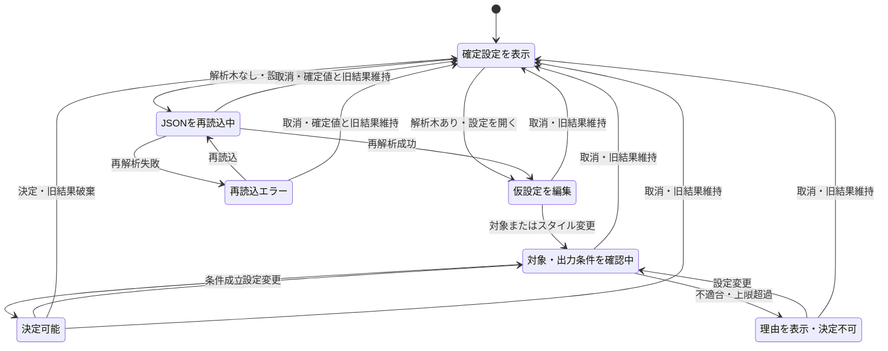

# local-document-preprocessor JSON入力追加 画面設計書

> **採用変更（2026-10-30）**: [最新設計](json-standard-mermaid-design.md)と§9.3/UI-24を優先する。標準Mermaid、図/ソース切替、スクロール、50 KiB超過/描画失敗時のソース利用を採用。図内ズーム・5秒強制中断は必須から外す。未検証本文は出力不可。製品PWA/読み上げ/実ブラウザー200%ズーム/タッチは別途で、本体統合保留・macOS/iOS対象外を維持する。

版: v0.2（追補1）\
作成日: 2026-10-22\
更新日: 2026-10-23\
状態: レビュー反映版。JSON機能の動作確認済みを意味しない。\
対象: [Bamboosato/local-document-preprocessor](https://github.com/Bamboosato/local-document-preprocessor)\
上位仕様: [JSON入力追加 要件定義書 v0.2](local-document-preprocessor-json-requirements-v0.2.md)

## 1. 設計方針

「現在何を選んでいるか」と「その選択で何が出力されるか」を、変換前に確認できるようにする。ツリーを開く行為で対象が変わらず、対象を仮選択するだけで既存結果が消えないことを重視する。

本版ではレビュー8項目の対応方針を採用し、項目表・一覧表・Mermaidソース生成と図表示・拡大縮小を今回の設計範囲とする。ライブラリや隔離方式の実現性確認は、上位仕様§13.1の検証ゲートとして本体統合前に実施する。[画面設計書v0.1](local-document-preprocessor-json-screen-design-v0.1.md)は履歴として保持する。

### 1.1 UIの判断

| 判断 | 採用する形 | 防ぐ混乱 |
| --- | --- | --- |
| 全体か部分か | ルートを含む一つのラジオグループ | 「全体」切替とツリー選択の二重管理 |
| 開閉と選択 | 矢印ボタンとラジオ＋ラベルを分離 | 内容を見ただけで対象が変わる |
| 対象の単位 | object／arrayだけにラジオ。ルートは型に関係なく選択可 | キー単位の除外・複数選択と誤解する |
| 含まれる範囲 | 選択対象・型・件数・直下内容をサマリー表示 | 選択行だけが出力されると誤解する |
| 表示外の対象 | サマリーを維持し「選択位置を表示」を用意 | 折りたたみやページ切替で選択を見失う |
| 設定反映 | 対象とスタイルを一括確定 | 操作途中に結果や設定が変わる |
| 出力スタイル不適合 | 選んだスタイルを保持し、理由と解決先を表示 | 自動変更に気付かず違う形式で変換する |

チェックボックス、全選択／全解除、行クリックによる開閉、ダブルクリックでの確定は使用しない。行の名称・型のラベル領域を押すと選択し、開閉は独立した矢印だけで行う。

### 1.2 既存画面への統合

新しいトップページや独立したJSONアプリを作らず、既存のファイル選択・キュー・範囲設定・結果カードへ組み込む。色、余白、ボタン、見出し、状態表示は既存アプリのスタイルを継承する。

本書の画面名・項目IDは設計上の識別子であり、利用者へ実装情報として表示しない。v0.2の更新基準は`f0eb983`、追補1のレビュー・更新基準は`10d7431b30c24c791a89db7e4cb503e804295d2d`。現行アプリがJSON対応済みという説明ではない。

## 2. 画面一覧と導線

| 画面ID | 名称 | 表示する内容 | 主な遷移 |
| --- | --- | --- | --- |
| SC-J01 | 入力・ファイル一覧 | JSON受付、構造確認状態、確定済み対象・スタイル | 構造確認後または「変更」でSC-J02、変換後SC-J03 |
| SC-J02 | JSON変換設定ダイアログ | ツリー、選択内容、出力スタイル、適用可否 | 決定／取消でSC-J01へ戻る |
| SC-J03 | 変換結果カード | 対象、スタイル、品質、Markdown／plain text、操作 | SC-J01の「変更」から再設定 |

エラーは発生箇所に表示し、新規のエラー専用画面は設けない。

### 2.1 単一ファイル

1. ファイルを選択する。
2. 構造確認中の状態を表示する。
3. 構造確認対象が一つで、その確認に成功した場合は、既存導線と同様にSC-J02を自動表示する。
4. 設定を確定、または初期設定のまま取消する。
5. ダイアログが閉じている状態で「変換開始」を押す。
6. SC-J03で結果を確認・コピー・ダウンロードする。

設定ダイアログ内に「変換開始」は置かない。対象・スタイルの決定と、キュー全体の実行を別操作にする。

### 2.2 複数・混在ファイル

構造確認終了後、各ファイルの設定要約と「変更」を表示する。ダイアログを順番に自動表示しない。設定は各ファイルに独立して保持し、変換は選択順に逐次実行する。

不正ファイル・設定不可の項目は理由を示し、正常項目の変換を妨げない。全項目の構造確認中、設定ダイアログ表示中、変換中は「変換開始」を無効にする。

## 3. 共通の設計用データ

ファイル名: `test-results.json`

```json
{
  "generatedAt": "2026-10-22",
  "summary": {
    "total": 2,
    "failed": 1
  },
  "results": [
    {"id": "T001", "name": "ログイン", "status": "OK", "duration": 120},
    {"id": "T002", "name": "検索", "status": "NG", "duration": 350}
  ]
}
```

ルート直下は3項目、`summary`直下は2項目、`results`は2件。項目表は全体16行、`results`以下11行、`results/0`以下5行となる。一覧表は`results`を対象に2行・データ4列とシステム1列になる。

## 4. SC-J01 入力・ファイル一覧

### 4.1 表示項目

| 項目ID | 項目 | 表示・動作 |
| --- | --- | --- |
| IN-01 | ファイル受付 | 既存の選択／ドロップ領域へJSONを追加。対応形式の説明とaccept属性も更新 |
| IN-02 | ファイル行 | 元ファイル名、サイズ、状態、形式JSONを表示。ファイル名は省略時も全体を確認可能にする |
| IN-03 | 設定要約 | 「対象：ファイル全体」「出力：項目表」。部分なら「対象："results"／2件」「出力：一覧表」等 |
| IN-04 | 変更 | 「JSONの変換設定」を開く。検査成功済みの元Fileと確定設定があれば、解析木が未保持でも開いて再読込可能 |
| IN-05 | 変換開始 | 既存キューを実行。構造確認終了・ダイアログ終了・変換可能項目ありの条件で有効 |
| IN-06 | クリア／中止 | 既存操作を継承。クリアは対象・ツリー・描画の参照も破棄 |

### 4.2 状態表示

| 状態 | 表示文 | 変更 | 変換対象 |
| --- | --- | --- | --- |
| 構造確認中 | JSONを確認中 | 不可 | まだ実行しない |
| 待機 | 待機中／対象とスタイルの要約 | 可 | 実行する |
| 解析失敗 | 形式・文字コード・重複キー等の理由 | 不可。ファイル再選択を案内 | 実行しない |
| 設定エラー | この設定では変換できません／理由 | 可。解析情報を保持 | 回復するまで実行しない |
| 変換中 | 変換中 | 不可 | 実行中 |
| 成功 | 変換成功（要原本照合） | 可。確定時に旧結果破棄 | 再確定で待機に戻る |
| 変換失敗 | 変換失敗／理由 | 元Fileと検査成功記録があれば可 | 再設定後に実行 |
| キャンセル | キャンセルしました | 元Fileと検査成功記録があれば可 | 再確定で待機に戻る |

設定要約にJSON Pointer全体を常時表示するとファイル一覧が読みにくくなるため、通常は名称・型／件数を表示し、補助領域を開くと絶対Pointerを確認できるようにする。識別自体はファイルID＋Pointerで行う。

上記の業務状態と解析木の保持状態は分ける。Worker再生成や別ファイルへの切替で解析木が失われても、「成功」や「キャンセル」の状態と確定設定・既存結果は維持する。「変更」を押すと必要なファイルだけを逐次再解析する。詳細は§6.3による。

## 5. SC-J02 JSON変換設定ダイアログ

### 5.1 基本レイアウト

PCでは次の構成とする。左右ペインの見出し順序はDOMの読み上げ順序とも一致させる。

| 領域 | 配置と内容 |
| --- | --- |
| ヘッダー | 「JSONの変換設定」、JSON文字列リテラル化した元ファイル名、必要時の再読込状態 |
| 対象選択領域・左 | 「対象を1つ選択」、JSONツリー、階層ごとのページ操作 |
| 選択内容領域・右 | 「選択範囲」、対象名、型・件数、絶対Pointer、直下内容、JSON詳細 |
| 出力スタイル領域 | 左右ペインの下に全幅。「項目表」「一覧表」「Mermaid構造図」、適用可否・出力予定量 |
| フッター | 常時見える現在の対象とスタイル、「キャンセル」「この設定に決定」 |

左右の分割比はおおむね1:1。ダイアログ幅は最大960px、左右16px以上の外側余白を確保する。幅768px未満では「対象選択」「選択内容」「出力スタイル」の順で縦に積む。

モバイルは画面幅に合わせたダイアログとし、スクロールする本文と見えるフッターを分離する。フッターが本文やフォーカス中の要素を覆わないようにする。ツリーペインごとの縦スクロールは設けず、ページ分けで表示量を制御する。

### 5.2 画面内の表示例

初期状態では「ファイル全体」が選択済み。ルートを展開し、直下の`summary`と`results`は折りたたむ。

| ツリー行 | 開閉 | 選択操作 | 型・件数 |
| --- | --- | --- | --- |
| ファイル全体 | 開いている | 選択済みラジオ | オブジェクト・3項目 |
| "generatedAt": "2026-10-22" | なし | 参照のみ | 文字列 |
| "summary" | 閉じている | ラジオで選択可 | オブジェクト・2項目 |
| "results" | 閉じている | ラジオで選択可 | 配列・2件 |

`results`の矢印を開いた後の直下表示:

| ツリー行 | 選択操作 | 補助表示 |
| --- | --- | --- |
| 1件目 [0] | ラジオで選択可 | オブジェクト・4項目 |
| 2件目 [1] | ラジオで選択可 | オブジェクト・4項目 |

各objectを開くと`id`、`name`、`status`、`duration`とその値を表示する。値から名称を推定して行の正式名にせず、配列位置を一意な表示とする。

`results`を選んだ場合の右ペイン:

| 項目 | 表示例 |
| --- | --- |
| 現在の対象 | "results" |
| 型・直下件数 | 配列・2件 |
| 含まれる範囲 | この配列の全2件と、それぞれの全内容 |
| JSON内の位置 | "/results" |
| 選択位置へ戻る | 「選択位置を表示」ボタン |
| 直下内容 | 1件目 [0]：オブジェクト・4項目／2件目 [1]：オブジェクト・4項目 |
| 詳細 | 「選択範囲のJSONを確認」を開くと、値を確認できる |

下の出力スタイルが「一覧表」なら、出力予定は「2行・4項目」。システム列の配列位置は項目数に含めないことを補助表示する。項目表なら「11行」。

### 5.3 ツリーの項目定義

| 項目ID | コントロール | 操作・仕様 |
| --- | --- | --- |
| TR-01 | 開閉ボタン | object／arrayの各行の左端。押すたびに開閉。選択とスタイルは変えない。空コンテナーには開閉を置かない |
| TR-02 | 対象ラジオ | 同じファイルの全選択可能ノードで1グループ。ルートとobject／arrayに表示 |
| TR-03 | 項目名・型のラベル領域 | ラジオに関連付け、名称・型の範囲を押しても選択する。開閉ボタンをラベル内に含めない |
| TR-04 | 単一値行 | 型とJSONリテラル値を表示。個別ラジオ・押下動作を設けず、テキスト選択は可能 |
| TR-05 | 選択行の強調 | 現在のラジオ選択行だけを背景と選択マークで示す。子孫を選択済みラジオとして表示しない |
| TR-06 | ページ操作 | 同じ親の直下が50項目を超えたら、表示範囲／総数と前後ページボタンを表示。選択状態を変えない |
| TR-07 | 総表示量の制御 | 同時描画300行まで。表示窓の移動／仮想化等で全行へ到達可能にし、未描画行を選択候補から除外しない |

ラベル省略時も全名称を操作で確認可能にし、accessible nameには全文を設定する。型・件数を色だけで区別しない。

### 5.4 右ペインの項目定義

| 項目ID | 項目 | 仕様 |
| --- | --- | --- |
| DT-01 | 対象名 | 全体、JSON文字列リテラル化したプロパティ名、配列の位置。必要に応じ親からの階層を区切って表示 |
| DT-02 | 型・件数 | objectは直下項目数、arrayは直下要素数。単一値ルートは型を表示 |
| DT-03 | 範囲の説明 | 「選んだ項目と、その下のすべてが対象です」。単一値ルートは「ファイルの値全体が対象です」 |
| DT-04 | JSON内の位置 | RFC 6901の絶対Pointer全体をJSON文字列リテラルとして折返し表示。ルートは「ファイル全体（ルート）」とPointer表記`""`を示す |
| DT-05 | 選択位置を表示 | 常時表示。必要時に再読込、祖先・ページ・表示窓を復元し、描画・スクロール後にラジオへフォーカス。対象・スタイルは変更しない |
| DT-06 | 含まれる内容 | 直下名と型・値のサマリー。10項目／ページ、表示範囲と総数を表示。ここに別の選択ラジオは置かない |
| DT-07 | JSON詳細 | 折りたたみ。選択範囲を整形して表示。数値字句を保持し、文字列はJSONエスケープで表す。表示用の整形であることを補助表示 |

DT-07は最大10,000コードポイント。超える場合は「先頭10,000文字の抜粋です。変換出力の省略ではありません」と表示する。全文を一度生成してから切るのではなく、必要量までを逐次取得する。詳細の表示量と変換対象の量を同じ扱いにしない。

対象詳細の取得中は、新しい対象名を示した上で「内容を確認中」とし、旧対象の内容を残さない。取得結果はファイルID・検査世代・対象Pointer・要求IDが一致するときだけ表示する。

### 5.5 出力スタイルの項目定義

| 項目ID | コントロール | 説明文・規則 |
| --- | --- | --- |
| FM-01 | 項目表ラジオ | 「パス・型・値を一覧にします」。初期選択。全対象で利用可能だが出力上限を検査 |
| FM-02 | 一覧表ラジオ | 「配列の各オブジェクトを1行にします」。不適合時も名称と理由を表示 |
| FM-03 | Mermaid構造図ラジオ | 「JSONの親子関係を図にします」。図形式の上限を確認 |
| FM-04 | 適用判定 | 対象やスタイル変更時に再判定。待機中は「出力条件を確認中」 |
| FM-05 | 出力予定量 | 項目表は行数、一覧表はデータ行数／データ列数、図はノード数。全内容を出すことを前提とした値 |
| FM-06 | 不適合・上限理由 | 該当スタイルの直下へ日本語表示。「項目表を選ぶ」等の明示操作を必要に応じて用意 |

Mermaidのラベル長はキー／型／件数／値／区切りを含む表示テキスト全体のコードポイント数とする。JSONリテラル化後・Mermaid構文エスケープ前に200まで、最終フェンス内コードはLF改行と末尾LFを含め50,000まで。上位仕様§6.5と同じ生成・検査を使う。絵文字の見た目の字数や値単体のlengthで可否を出さない。

未選択で不適合なスタイルは無効ラジオと理由を表示する。一覧表を選択した後に不適合対象へ変えた場合は、選択表示を残しつつ不適合を明示する。「この設定に決定」は、対象を適用可能なものへ変更するか、ほかのスタイルを選び、現在の仮設定に対する適用判定・必要データの取得が正常完了するまで無効とする。適合する対象へ戻した場合は一覧表の選択を保持したまま決定可能とし、別スタイルを選ぶ操作を必須にしない。旧対象の応答で有効化しない。

一覧表の利用条件は、非空配列で、すべての要素が1項目以上を持つobjectであること。単一値配列・混在配列・空配列・空objectを含む配列には適用しない。型を自動変換して表にしない。

### 5.6 フッター

| 項目ID | コントロール | 仕様 |
| --- | --- | --- |
| FT-01 | 現在の仮設定 | 例「対象："results"・2件／出力：一覧表」。幅が狭い場合も折返しで読める |
| FT-02 | キャンセル | 仮の対象・スタイルを破棄して閉じる。確定済みの設定・旧結果を維持 |
| FT-03 | この設定に決定 | 有効な対象とスタイルで、適用判定・必要データの取得が終了したときだけ有効 |

FT-03でファイル別の確定設定を更新し、既存結果を破棄して待機状態へ戻す。初回を含め、確定操作では自動変換を開始しない。

初回取消では初期設定「ファイル全体／項目表」を使う。ただし、その設定が出力上限等で不可なら設定エラーを表示し、変更から回復させる。取消で不可な設定を変換可能扱いにしない。

## 6. 操作の状態遷移

設定の確定状態と、ツリーの表示状態を別に扱う。

| 状態区分 | 保持するもの | 結果への影響 |
| --- | --- | --- |
| 確定設定 | ファイルID、選択Pointer／全体、スタイル、設定版 | 変換要求はこれを使用。再解析だけでは書き換えない |
| 仮設定 | ダイアログ内で操作中の対象とスタイル | 決定するまで旧結果に影響しない |
| 表示状態 | 展開ノード、階層ごとのページ、スクロール、詳細の開閉 | 変換対象を変えない。メモリだけで保持 |

表示状態はキャンセルしてもそのファイルのメモリ上に保持してよい。再度開くと仮設定は必ず確定設定から作り直し、前回取消した対象を再採用しない。復元された表示位置と確定対象が違っていても、確定対象を維持し、サマリーと「選択位置を表示」を使えるようにする。



初期設定の適用判定も同じ経路を通す。展開・折りたたみだけではCheckingへ遷移せず、設定版も更新しない。

### 6.1 重点操作シナリオ

| 操作 | 選択範囲 | 画面・結果 |
| --- | --- | --- |
| 初回に開く | 全体 | ルート選択、項目表、右に全体の内容 |
| resultsの矢印を押す | 全体のまま | 2件のobjectを表示。右の対象は変わらない |
| resultsの項目名を押す | results以下 | 右・フッターが即時更新。出力条件を再判定 |
| resultsを閉じる | results以下のまま | 選択行は見え、子だけ閉じる |
| results/0選択後にresultsを閉じる | results/0以下のまま | ツリー上の対象が隠れても右・フッターは保持 |
| 選択位置を表示 | 変更なし | resultsを開き、該当ページとラジオへ移動 |
| rootを選ぶ | 全体 | 矢印の開閉状態は保ち、対象だけを全体へ戻す |
| キャンセル | 元の確定範囲 | 仮設定を捨て、旧結果を残して閉じる |
| この設定に決定 | 仮設定を確定 | ダイアログを閉じ、旧結果破棄・待機へ |
| 同じ設定で再決定 | 同じ範囲 | 既存の再変換導線に合わせ、旧結果を破棄して待機へ |

### 6.2 一覧表が不適合になる例

1. 対象`/results`・スタイル一覧表を選択する。
2. 対象を`/summary`へ変える。
3. 一覧表の選択表示を保持し、「一覧表はオブジェクトが並ぶ配列で利用できます」と表示する。
4. 確定は無効。対象を`results`へ戻すか、項目表／Mermaidへ明示変更する。
5. 対象を`results`へ戻した場合は一覧表の選択を維持する。適用判定・必要データの取得中は決定不可、正常完了後はそのまま決定可能とする。

### 6.3 解析木がない場合の再読込

解析キャッシュは原則1ファイル分だけとする。別JSONの事前検査や変換、Worker再生成で解析木が消えた場合は、この経路を共通で使う。Worker消失を入力ファイル消失と扱わない。

| 解析状態 | ダイアログの表示 | 利用可能な操作 | 設定・既存結果 |
| --- | --- | --- | --- |
| 未保持 | 開いた直後に「JSONを再読込中」へ | 取消 | 確定済みサマリーと結果を保持 |
| 再読込中 | 元ファイル名・確定対象のサマリー、読込表示。別ファイルの古いツリー・詳細を表示しない | 取消のみ。対象・スタイル・決定は不可 | 旧結果を維持 |
| 再読込成功 | 確定値から仮設定を生成。表示位置を可能な範囲で復元 | 対象・スタイル・決定・取消 | 利用者の決定前は旧結果を維持 |
| Pointer不整合 | 以前の範囲を確認できないと明示。有効なツリーは閲覧可能 | 対象の選び直し・取消。決定不可 | 旧Pointerをエラーとして保持し、全体へ自動変更しない |
| 再読込失敗 | 日本語の理由。「JSONを再読込できませんでした」 | 再読込・取消、必要に応じファイル再選択の案内 | 確定値と完了済み結果を維持 |

再読込は逐次実行し、複数ファイルを自動先読みしない。閉じた後に返った応答や、Worker世代・解析世代が変わった応答は画面へ反映しない。再読込のために中断済みの変換キューを再開しない。

JSON A完了→PDF Bをキャンセル→Aと未処理JSON Cの設定を開く操作では、Aの旧結果が利用でき、A／Cの設定をそれぞれ復元できることを確認する。再読込失敗時だけはその項目の新たな変換を停止し、ほかの正常項目は実行可能とする。

## 7. 特殊データの表示

| データ | ツリーとサマリーの表示 |
| --- | --- |
| ルートobject／array | 「ファイル全体」。展開して子を閲覧可能 |
| ルートstring／number／boolean／null | 「ファイル全体」のラジオだけ。型と値を右に表示。一覧表は理由付きで不可 |
| 空object／array | 型と0項目／0件。選択可能、展開ボタンなし。一覧表は不可 |
| 空キー | 項目名を`""（空の項目名）`と表示。位置欄は`"/"`。ルートのPointer`""`と区別 |
| `/`・`~`・ドット入りキー | キー名をJSON文字列リテラルで表示。位置欄は正しいJSON Pointerを同様に文字列化。表示文字列の分割で対象を識別しない |
| 同名の入れ子キー | 位置欄・親の階層で区別。ラジオのaccessible nameにも位置を含める |
| 数字だけのobjectキー | キー名として引用表示。arrayの「1件目 [0]」表記と区別 |
| 長いキー | 2行程度で省略可能。全文表示操作を用意。位置欄は折返しで全文確認可能 |
| 長い値 | ツリーでは先頭80コードポイントと省略記号。詳細に全文または明示した抜粋。出力には影響しない |
| 改行・制御文字 | キー・Pointer・ファイル名もJSON文字列リテラルとしてエスケープ。改行で行・ラベル・表を壊さない |
| 9007199254740993等 | 元の数値トークンを表示。丸め・指数変換・桁区切り挿入をしない |
| HTML／Markdown相当文字列 | 常にデータの文字列として表示し、リンク・画像・HTMLを生成しない |

ファイル名を含むキー・値の全文表示は、ホバー専用にせず、タップ・キーボード操作でも利用できるようにする。

位置欄・本文の表記は、通常のPointerを`"/results/0"`、キー内の実改行を`"/a\nb"`、バックスラッシュとnの2文字を含むキーを`"/a\\nb"`とする。タブも`"/a\tb"`と`"/a\\tb"`を区別する。元の内部Pointerは変えず、MarkdownではJSON文字列化後にさらに文脈に応じてエスケープする。サマリーの人向け名称と、位置欄の可逆表記を取り違えない。

## 8. 大きいJSONの操作

### 8.1 ツリー

- 直下50項目ごとにページを切り替え、「1–50／全126項目」のように表示する。
- 展開していない子孫をDOMへ全展開しない。ページ移動・展開だけで解析や変換全体をやり直さない。
- 選択中の対象が別ページにあっても選択を解除しない。
- 「選択位置を表示」は対象を含むページへ移り、必要な祖先を展開する。深い対象をたどり直させない。
- 項目は入力順を維持する。並び替え・検索は初版に含めない。
- 直下のページ数とは別に、ツリー全体の同時描画行を300までとする。表示窓の移動／仮想化等の方式は上位仕様G-03で選ぶ。全行をラジオやラベルとして事前生成する回避策は使わない。
- 字下げは1階層16px、最大64pxに抑える。深さ5以上は「階層N」と位置欄で階層を補い、320pxでもラベルと操作領域を確保する。
- 表示窓を外れた選択も保持する。スクロールや表示窓の切替だけでラジオのchangeを発生させない。

「選択位置を表示」は、必要な再解析と祖先・ページ・表示窓の復元を行い、対象ラジオがDOMに描画されてからスクロールし、フォーカスが対象へ移ったことを確認して完了通知する。途中で対象変更・取消・世代変更が起きた場合は旧要求を取り消す。対象が存在しない場合はエラーとし、別のラジオへフォーカスして成功扱いにしない。

### 8.2 プレビューと出力の区別

設定の直下内容は10項目／ページ、JSON詳細は先頭10,000コードポイント、結果表は100行／ページとする。これらは表示上の上限であり、出力本文は全件生成する。

「画面に表示している範囲だけをダウンロードする」と誤解しないよう、表結果には常に「表示1–100／全300行。コピー・ダウンロードは全300行」といった情報を示す。

表の長いセルは折返し、行数が多い場合はページ分けする。列が収まらない表と図の拡大領域だけ横スクロールを許可する。画面全体を横スクロールさせない。

### 8.3 上限表示

| 状況 | 表示・操作 |
| --- | --- |
| 全体は項目表10,000行を超えるが解析は成功 | 設定エラー。ツリーは閲覧でき、部分選択へ変更可能 |
| 一覧表のデータ列が100を超える | 「一覧表は最大100項目です」。無通知で列を削らない |
| Mermaidが200ノードを超える | 「構造図は最大200ノードです。対象を小さくするか、表形式を選んでください」 |
| キー・型等を含む表示ラベル全体が200コードポイントを超える等 | 図形式を不可とし、理由と表形式への変更を案内 |
| 解析全体の深さ128／100,000ノードを超える | 構造確認失敗。ツリーを部分成功として出さず、入力分割を案内 |
| 巨大な単一値等で全スタイルが不可、小さいコンテナーもない | 「入力を分割・縮小して再選択してください」。不可能な対象縮小を繰り返し案内しない |

出力条件の判定中は決定不可とし、利用者が対象を変えた後に旧対象の適用結果を表示しない。

## 9. SC-J03 変換結果カード

### 9.1 共通構成

| 項目ID | 項目 | 表示・動作 |
| --- | --- | --- |
| RS-01 | ファイル名・JSON表示 | 既存結果見出しに統合 |
| RS-02 | 確定対象・スタイル | 例「対象："results"／2件」「出力：一覧表」。全体の場合も明示 |
| RS-03 | 品質通知 | 「変換成功（要原本照合）」と既存通知。部分選択だけで部分結果の警告にしない |
| RS-04 | Markdown／plain text切替 | 既存の出力タブ。選択したタブにコピー・ダウンロード対象が連動 |
| RS-05 | 出力プレビュー | 表は表として表示。図形式は図／ソースを切替。plain textはテキスト表示 |
| RS-06 | コピー／ダウンロード | 有効な生成結果の全量を使用。表示ページやプレビュー抜粋には依存しない |
| RS-07 | 操作通知 | 成功・コピー権限エラーなどをaria-liveで通知 |

結果カードの対象・スタイルは、その結果を生成した確定設定のスナップショットを表示する。ダイアログ内の仮設定を反映しない。

### 9.2 表形式

項目表は「パス／型／値」、一覧表は「配列位置／キーの和集合」を表示する。列・セルの表記と欠損値の扱いは上位要件に従う。

ページ操作で表の表示だけを変え、コピー／ダウンロードは常に生成した全本文を対象にする。空object／arrayの項目表は0件のコンテナー行を表示し、空白の成功結果にしない。

### 9.3 Mermaid形式

Markdownタブ内に「図」「Mermaidソース」の切替を置く。初期は図、見出しは「JSON構造図」。標準Mermaidで描画し、ソースを確認するために別画面へ移動させない。表示基準はknowledge-board同等とする。

| 状態 | 表示 | 出力操作 |
| --- | --- | --- |
| 生成・構文検証に成功、図を描画中 | 図を表示中／ソースへの切替 | 検証済みMarkdownはコピー・ダウンロード可 |
| 描画成功 | 標準構造図、スクロール表示 | コピーするのは画像でなくMarkdown本文 |
| 図の描画失敗 | 「図を表示できませんでした。Mermaidソースを利用できます」 | 検証済み本文は利用可能 |
| 図コードのUTF-8が50 KiB超過 | 「図が50 KiBを超えるため自動描画しません。Mermaidソースを利用できます」 | 検証済み本文は利用可能。生成上限とは別判定 |
| Mermaidの生成・構文検証失敗 | 変換失敗、出力停止 | プレビュー・コピー・ダウンロード不可 |

生成ソースの元データ値を省略しない。図領域はキーボードで到達・スクロール可能とし、表示上の折返しや大きな図はソース切替でも確認できる。図内ズーム・全体表示・100%リセットは必須から外す。図操作で本文・選択対象を変更しない。

plain textタブでは「図の画像は含まれず、Mermaidの記述が出力されます」と説明する。コピー／ダウンロードは既存と同じplain text規則を使用する。

#### 図資産の取得・初期化と再試行

| 状態 | 表示と操作 |
| --- | --- |
| 資産取得・初期化中 | 遅延読込し「図を表示中」。生成・構文検証済みならソースと出力を維持。強制中断の時間保証はしない |
| 初期化後の描画中 | 300ms debounce後、標準描画を逐次実行。旧要求の完了を表示しない。同期処理中のUI応答を保証しない |
| 図表示用資産が未取得のオフライン／初期化失敗（検証済み本文あり） | 結果カードに「図の表示に必要なデータを読み込めませんでした」と「図を再試行」。本文のコピー／ダウンロードは維持 |
| 検証済み本文から図の表示を再試行 | 利用者の操作で新しい表示要求IDを作成。資産の遅延取得と標準描画だけを試し、本文・品質状態・変換キューを再生成しない |
| 構文検証用資産も未取得（有効な結果なし） | ファイル行に変換失敗と「オンラインで『変更』から設定を再確定し、変換を開始してください」を表示。出力と「図を再試行」は提供しない |
| クリア・結果変更・取消 | 表示要求を失効し、検証Workerとdebounceを取消。実行中の標準renderの強制停止は保証せず、後から来た図を画面へ戻さない |

図資産取得済みのオフラインと、未取得／キャッシュ消去後を区別して試験する。オンライン復帰だけでは自動で再試行せず、利用者に明示操作を案内する。表示の実現方式は上位仕様G-04の試作で確認してから本体へ統合する。

#### 構文検証未完了からの回復導線

1. 有効な結果がない場合はSC-J01の該当ファイル行を変換失敗とし、出力操作を停止する。未検証の本文を結果カードの図再試行に渡さない。
2. オンライン復帰後、利用者が該当ファイルの「変更」でSC-J02を開き、対象・スタイルを確認して「この設定に決定」を押す。同じ設定の再確定を許可し、該当ファイルだけを待機へ戻す。
3. SC-J01の「変換開始」で既存の待機キューを逐次処理し、該当ファイルの生成・構文検証・品質判定を再実行する。成功して初めて本文・コピー／ダウンロードを利用可能とする。再び失敗すれば出力停止を維持する。
4. 別ファイルの完了済み・失敗・キャンセル状態を自動で待機へ戻さず、完了済み結果を再実行・破棄しない。ほかの待機項目は通常のキュー規則に従う。

専用の再検証ボタンは追加しない。検証済み本文ありの「図を再試行」は、その結果のファイルID・確定設定版・生成実行に結び付け、別ファイル・旧設定の本文や未検証本文への出力許可に流用しない。

## 10. エラー表示と回復

| 発生場所 | 表示場所 | 回復 |
| --- | --- | --- |
| 受付・解析 | SC-J01の該当ファイル行 | ファイルを修正して再選択。ほかの正常項目は変換可能 |
| 対象詳細取得 | SC-J02の右ペイン | 「内容を確認できませんでした」。再取得操作を置く。確定不可 |
| 必要時再解析 | SC-J02の読込領域 | 「JSONを再読込できませんでした」。再読込／取消。確定設定と旧結果は維持 |
| 対象パス不整合 | SC-J02の対象領域 | 「選択した範囲を確認できません」。有効なラジオを選び直す |
| スタイル不適合・出力上限 | SC-J02の該当スタイルの近く | 対象／スタイルを明示的に変更 |
| 生成・検証失敗 | SC-J01の該当行および既存の失敗表示 | 出力停止。「変更」で再設定可能なら案内 |
| 図表示のみ失敗 | SC-J03の図領域 | ソースへ切替、「図を再試行」。生成結果自体の失敗と混同しない |
| 図表示用資産の取得／初期化失敗（検証済み本文あり） | SC-J03の図領域 | 「図を再試行」。本文・品質状態・コピー／ダウンロードを維持 |
| 構文検証用資産の取得失敗（有効な結果なし） | SC-J01の該当ファイル行 | 「変更→この設定に決定→変換開始」。生成・構文検証成功まで出力停止。「図を再試行」で代用しない |

エラーには原文の抜粋・キー名・ローカルパス・スタックトレースを表示しない。構文エラーは1始まりの行・列を出す。重複キーはキー名を出さず、理由だけを通知する。

複数の問題がある場合は「対象不整合」「詳細／適用判定待ち」「スタイル不適合」「出力上限」の順で主要な回復操作を示す。選べる別スタイルがあっても無通知で切り替えない。

## 11. キーボード・読み上げ・タッチ

### 11.1 フォーカスと取消

- ダイアログにはrole=dialog、aria-modal、見出しとの関連を付ける。
- 開いたときはダイアログ見出しへフォーカスし、操作順序を「ツリー、詳細、スタイル、取消、決定」とする。
- ダイアログ内でフォーカスを循環させ、背景のファイル行や「変換開始」へ移動させない。
- Escape、キャンセルボタン、背景領域そのものの押下は取消。ダイアログ本文の押下を背景押下として扱わない。
- 終了後は起点の「変更」へ戻す。初回自動表示の終了後は該当行の「変更」、起点が消えた場合はファイル選択へ戻す。

### 11.2 コントロール

| 操作 | 規則 |
| --- | --- |
| Tab／Shift+Tab | ネイティブの操作順序で移動。正のtabindexを使わない |
| 開閉ボタンのEnter／Space | 展開・折りたたみだけ。フォーカスを同じボタンに維持 |
| ラジオのSpace／方向キー | ネイティブの単一選択操作。ラベルと選択範囲の変更を通知 |
| ページ操作のEnter／Space | 表示範囲だけ切替。フォーカスは操作元へ維持し、新しい表示範囲を通知 |
| 選択位置を表示 | 必要時再解析し、祖先・ページ・表示窓を復元。描画・スクロールの後に対象ラジオへフォーカス |
| 決定不可 | 無効理由を近くに表示し、aria-describedby等で関連付け |

単純な入れ子リスト＋ネイティブラジオ＋ボタンとして構成する。role=treeを形式的に付けて、必要なツリーキーボード操作を欠く実装にはしない。

折りたたみで選択ラジオが非表示になっても、サマリーと「選択位置を表示」は残す。Tab操作で見えている選択肢へ移動し、明示的なラジオ操作で初めて対象を変える。

Tab／Shift+Tabによるフォーカス移動だけでは対象を変えない。方向キー・Space等の明示選択との区別を、選択済みラジオが未描画の状態でも実ブラウザで確認する。ネイティブラジオを置いただけで期待動作を保証したとしない。未描画の全ラジオを追加せず、上位仕様G-03で選んだ表示窓方式に合わせてフォーカスを管理する。

### 11.3 読み上げと表示

- ラジオの名前に対象の全文・型・階層上の位置を含める。
- 開閉ボタンには対象名と開閉状態を示し、aria-expandedを更新する。
- 対象の変更はaria-live=politeで1回通知する。詳細取得完了時も別対象の古い通知を出さない。
- エラーはrole=alertを必要な箇所だけに使い、ツリーの全行や展開ごとの全文を読み上げ直さない。
- 選択はラジオと背景、エラーは文言と記号でも示し、色だけに依存しない。
- タッチ対象はおおむね44×44pxを確保。矢印と選択ラベルの当たり判定を重ねない。
- 320px、縦横切替、200%拡大で対象・理由・決定／取消を操作可能にする。

## 12. 状態データの設計指針

画面ロジックをレビューするためのモデルであり、実装の型名・配置は固定しない。

| データ | 必要な内容 | 注意点 |
| --- | --- | --- |
| ファイル識別 | 一意なID、元File、検査世代 | 同名ファイルを名前だけで対応付けない |
| 確定設定 | 全体／JSON Pointer、出力スタイル、設定版 | 実行要求と結果へスナップショットとして関連付け |
| 仮設定 | 確定値のコピー、適用確認状態 | 取消時に確定値へ混入しない |
| ツリー表示 | 展開パス集合、親ごとの表示ページ | 生成対象を決める情報には使わない |
| 詳細要求 | 対象Pointer、要求ID、世代、読込状態 | 急速な対象切替で応答順が逆でも混在させない |
| 結果表示 | 出力タブ、表のページ、図／ソース、描画要求ID | 出力本文と独立。古い図を新結果へ描かない |
| 解析状態 | Worker世代、ファイル別解析世代、未保持／保持／再読込中／失敗 | 業務状態・確定設定・設定版と分離。全解析木を画面へ複製しない |
| 表示窓 | 最大300行の表示範囲、深さ・フォーカス対象の要求ID | ページ・展開・表示位置は元Fileのノード識別と対応付け、選択範囲に使わない |
| 標準図表示 | 資産取得/描画状態、50 KiB判定、描画世代、300ms debounce | 再試行・クリア後の旧応答を受け入れない。同期renderの時間保証なし |

objectのキーは文字列データとして保持し、画面側の辞書を汚染しない方式を使う。ツリー名から式を組み立てず、Pointerを解析木へ解決する。

## 13. UI受入シナリオ

テストケース化の前に、上位要件の機能・非機能・データ・UIの観点を整理する。以下は代表的な受入シナリオで、網羅的テスト一覧ではない。

| ID | 前提・操作 | 期待結果と意図 | 主な対応要件 |
| --- | --- | --- | --- |
| UI-01 | サンプルJSONを単一選択 | 全体／項目表、ルート展開、直下コンテナー折りたたみ。初期対象を明確化 | J-SC-01、J-ST-01 |
| UI-02 | resultsの矢印を開閉 | 選択・右ペインの対象・スタイルは不変。閲覧と選択の混同を防ぐ | J-SC-01～04 |
| UI-03 | resultsのラベルを押す | ラジオ、右ペイン、位置、フッターがresultsに一致。出力条件を確認 | J-SC-02、J-SC-05 |
| UI-04 | results/0選択後、親を閉じ、選択位置を表示 | 選択保持、祖先と該当ページ復元、対象ラジオへフォーカス | J-AC-05 |
| UI-05 | 既存結果あり。対象とスタイルを変え取消 | 元の設定・結果を維持。再オープンの仮設定は元の確定値 | J-ST-03、J-AC-06 |
| UI-06 | 同条件で設定を決定 | 確定値が更新され、旧結果が消え待機。明示実行まで変換しない | J-ST-03 |
| UI-07 | results／一覧表からsummaryへ変更 | 一覧表の選択は保持、不適合理由を表示、決定不可。勝手に項目表へ変えない。戻した後の回復はUI-25で確認 | J-OUT-02、J-AC-22 |
| UI-08 | 空object・空array・ルート単一値 | 選択規則・0件表示・一覧表不可理由が一致。空成功の誤認を防ぐ | J-IN-04、J-SC-02～03 |
| UI-09 | 空キー、/、~、数字キー、同名の入れ子 | 表示名と正しいPointerの対応が崩れず、意図した値を選択 | J-SC-05～07 |
| UI-10 | 同じ親に51項目、別ページに対象 | ページと選択を独立保持。戻る操作で対象を表示 | J-AC-05、J-AC-09 |
| UI-11 | 結果表101行を出力 | 100行＋次ページ、コピー／ダウンロードは101行すべて | J-AC-09、J-AC-11 |
| UI-12 | 対象を連続切替し応答順を逆転 | 右ペイン・出力可否に古い対象の内容を採用しない | J-ST-05 |
| UI-13 | 図200／201ノード、図表示をタイムアウト | 境界と回復文言が一致。生成失敗と表示失敗を区別 | J-AC-09、J-AC-12 |
| UI-14 | JSONとPDFを選択し片方だけ設定変更 | ファイル別設定が混ざらず、既存ページ設定が機能する | J-ST-07、J-AC-15 |
| UI-15 | キーボードだけで対象選択・取消・決定 | 背景へフォーカスが漏れず、取消／決定後に起点へ戻る | J-AC-14 |
| UI-16 | 320px、拡大200%、長いキーとファイル名 | 決定／取消・位置・エラー理由を読め、画面全体が横にはみ出さない | J-AC-14 |
| UI-17 | JSON A完了→PDF B取消→A／C設定を開く。Worker異常も別途確認 | 必要時再解析で復元し、Aの結果・A／Cの確定設定を保持。古い応答は採用しない | J-AC-16 |
| UI-18 | 原則1解析セットで20ファイル事前検査、連続切替、再読込失敗／取消 | キャッシュを蓄積せず、ファイル再選択を強制せず回復。失敗時は再試行と取消を使える | J-AC-16、J-AC-17 |
| UI-19 | 実改行とバックスラッシュn、実タブとバックスラッシュtを同時に持つキー | 画面・Markdown AST・plain textのPointerが可逆で、列区切りを増やさない | J-AC-18 |
| UI-20 | 表示ラベル全体199／200／201、絵文字・型付加・構文エスケープ増加 | 設定可否と生成結果が一致。コード部49,999／50,000／50,001と本文上限も別に確認 | J-AC-19 |
| UI-21 | 展開結果299／300／301行、深さ128、320px | 同時描画上限・字下げ上限を守り、全ノードを選択可能 | J-AC-20 |
| UI-22 | 別対象を仮選択し取消、復元位置と確定対象が離れたまま再オープン | 確定値を選択したまま、Tabだけでは対象不変。選択位置表示の完了後に正しいラジオへフォーカス | J-AC-20 |
| UI-23 | 図資産未取得オフライン、取得済みオフライン、取得／初期化失敗と再試行 | 適切な理由・再試行と出力可否。未検証ソースを成功にしない | J-AC-21 |
| UI-24 | 図コード51,199/51,200/51,201 UTF-8 bytes、失敗直後の再試行・クリア・結果切替 | 上限超過は自動描画を止め検証済み本文を保持。旧図が復活しない。5秒強制中断は対象外 | J-AC-21 |
| UI-25 | results＋一覧表→summary＋一覧表→results＋一覧表。対象詳細の応答順も逆転させる | 一覧表を維持し、現在の設定の判定・取得中は決定不可。正常完了後は別スタイルへの変更なしで決定可能。古い応答では有効化しない | J-AC-22 |
| UI-26 | 検証済み図の表示だけ失敗する場合と、検証資産未取得で有効な結果がない場合を分け、オンライン復帰後に回復する | 前者は図再試行のみで本文・品質を維持。後者は変更・再確定・変換開始で生成／構文検証を再実行し、成功前の出力を拒否。自動実行せず、別ファイルの完了済み結果を維持 | J-AC-23 |

## 14. 実装レビューの確認点

1. 選択を表す状態が一つに集約され、ルート選択と部分選択が競合しないか。
2. 表示用に切った値・省略したラベルを変換入力へ再利用していないか。
3. 取消・Escape・背景クリックで旧結果が失われないか。
4. 対象と出力スタイルの適用判定が、確定時・変換時にも行われるか。
5. ページ切替や親の折りたたみで選択パスを変えていないか。
6. 非同期要求にファイル・世代・対象・設定版の対応があるか。
7. Mermaid追加によって外部通信・外部リンク・raw HTMLが許可されていないか。
8. 既存Office／PDF／CSVの設定・結果とJSON設定が分離されているか。

## 15. レビュー対応と検証ゲート

| レビュー指摘 | 本書の反映先 | 上位仕様の対応 |
| --- | --- | --- |
| 1 採用範囲 | §1、§9.3 | §1.2、G-04 |
| 2 Worker回復 | §4.2、§6.3、§12、UI-17～18 | J-RC-01～07、J-AC-16 |
| 3 保持予算 | §6.3、§8、UI-18 | §10.1、G-02、J-AC-17 |
| 4 Pointer表記 | §5.2・5.4、§7、UI-19 | §6.4、J-AC-18 |
| 5 ラベル計数 | §5.5、§8.3、UI-20 | §6.5、J-AC-19 |
| 6 ツリー総量 | §5.3、§8.1、UI-21 | §10.2、G-03、J-AC-20 |
| 7 非表示ラジオ | §6、§8.1、§11.2、UI-22 | J-AC-20、G-03 |
| 8 図試作 | §9.3、§10、UI-23～24 | §13.1、G-04、J-AC-21 |

今回の文書更新では、画面動作・JSON実装・隔離図表示・性能・実機・読み上げの検証を行った扱いにしない。実装ではG-01～G-04を確認してから本体統合し、対象限定の試験にする場合は理由・未確認事項を記録する。

### 15.1 v0.2レビューの追補

| 今回の指摘 | 本書の反映先 | 上位仕様の対応 |
| --- | --- | --- |
| 1 適合対象へ戻したときの決定条件 | §5.5、§6.2、UI-07・25 | §6.1、J-AC-22 |
| 2 図再描画と未検証からの再変換 | §9.3、§10、UI-26 | §9.1、§12、§13.1、J-AC-23 |

## 16. 変更履歴

| 版 | 日付 | 内容 |
| --- | --- | --- |
| v0.1 | 2026-10-22 | 入力・設定・結果の3画面、対象選択UI、状態・取消・大容量表示・アクセシビリティを整理 |
| v0.2 | 2026-10-23 | 再解析の画面状態、保持・描画上限、Pointerの可逆表示、ラベル計数、非表示ラジオ・表示位置、図初期化と再試行を補足 |
| v0.2（追補1） | 2026-10-23 | 一覧表を維持した確定条件の回復と、検証済み図の再描画／未検証状態からの再変換を統一。UI-25～26を追加 |
