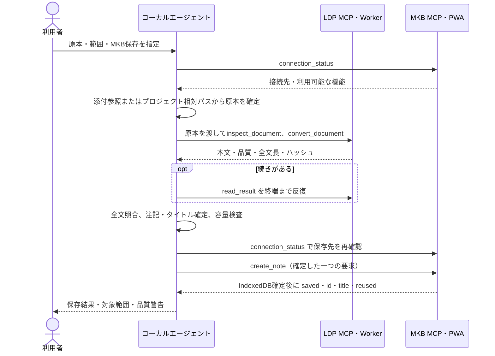

# ローカルエージェントによるLDPのMarkdown変換とMKBへの保存　要件・UI仕様・基本設計

対象は同じWindows PC上のローカルエージェント、LDP、MKB。2026-11-26に第1段階のLDP側を実装した。[初回登録とホストからの使用方法](../tools/local-mcp/README.md)を参照。第2段階のMKB自動起動と第3段階の総合テストは計画段階である。

## 1. 想定する操作と完了条件

「このチャットに添付した会議資料.pdfの3～5ページをMKBに保存して」、または「このプロジェクトの `docs/仕様書.pdf` をLDPで変換してMKBに保存して」と依頼する。利用者は原本を専用フォルダーへコピーする必要がない。ローカルエージェントが指定された1件を変換し、保存先のノートID・タイトル・範囲・品質上の注意を返す。

| 標準入力 | 利用者が指定するもの | 有効な範囲 |
| --- | --- | --- |
| チャット添付 | このチャットの添付のうち1件。「添付したPDF」の候補が1件ならそのまま使う。 | ホストが現在のチャットで参照を許す添付原本。プロジェクト外に由来するファイルでも、添付した1件を対象にできる。 |
| プロジェクト文書 | 現在のプロジェクトのルートからの相対パス。 | ホストがこのチャットに割り当てたワークスペースの配下。worktreeを使用するチャットではそのworktreeを基準にする。 |

対象が同名・複数で特定できない場合は「このチャットの添付」と「プロジェクトの `docs/仕様書.pdf`」のように候補を区別して確認する。プロジェクト未割当のチャットでも、添付経路は単独で利用できることを要件とする。

完了条件はMKBがIndexedDBへの保存を確定し、`status: "saved"` とノートIDを返したこと。変換だけ完了、保存前に停止、保存成否が不明の各状態を区別する。初版は1原本の全体または明示範囲を1ノートに保存する。既存ノートの更新、フォルダー一括登録、自動同期は別の用途とする。

## 2. 役割と起動方式

```text
原本 → LDPのローカルMCP（検査・Markdown変換・品質判定）
                 ↓ Markdownと品質情報
          ローカルエージェント（保存内容を確定）
                 ↓ create_note
       MKBのローカルMCP → 接続済みMKB PWA → 新規ノート
```

- **エージェント**　LDPとMKBを別々のSTDIOサーバーとして登録し、ツールを順番に呼ぶ。LDPは単体でも使用でき、MKBの認証情報やDB形式への依存を持たない。MKB保存は利用者がその出力先を指定したときに実行する。
- **LDP**　ローカルエージェントにサーバーの起動コマンドをユーザー単位で一度登録する。各チャットや各プロジェクトでの登録は不要。ホストは依頼ごとに現在のチャットの添付とワークスペースを識別し、選ばれた原本だけをLDPへ渡す。登録済みサーバーの起動フォルダーをプロジェクトとみなさない。原本と変換結果は処理中のメモリに保持する。
- **MKB**　第1段階の疎通には手動接続した現行MKBを使う。第2段階では、利用者が初回に保存先をペアリングして自動接続を有効にすると、次の保存依頼から登録済みのMKBを必要時に起動して接続する。MKBではSTDIOサーバーから認証付きループバックの共有brokerを経由し、PWAが保存する。新規作成に既存ノートの読み取り・更新許可は不要。エージェントは保存前に接続先Originと `create_note` が利用できることを確認する。[MKBの確定仕様](https://github.com/Bamboosato/markdown-knowledge-board/blob/main/docs/local-mcp-note-access-spec.md) ／ [MKBの導入手順](https://github.com/Bamboosato/markdown-knowledge-board/blob/main/tools/local-mcp/README.md)
- **実行環境の候補**　LDPの初回PoCでは、ローカルMCPが必要時にバックグラウンドのChromiumを起動し、同梱のアプリ資産と既存の文書・JSON Workerを利用する。PDFiumによる独立比較、ページ範囲、JSON図の検証を既存処理のまま試せるためである。ブラウザ起動・終了はランタイムが担う。Node Workerだけで動かす案もあるが、WASMの資産解決、PDFium初期化、JSON図検証の移植性は未確認。どちらもエージェント向けツール契約は共通とする。[現行の構成](architecture.md) ／ [Worker採用の判断](adr/0001-browser-only-anydoc-wasm.md)

MKBから流用するのは、エージェントがSTDIOでツールを呼び、保存操作を要求IDと確定応答で追跡する考え方。LDPはエージェントが指定したファイルを入力とするため、ブラウザ内のノートを公開するための共有brokerやペアリングを新設する必要はない。初版の動作確認環境はWindowsとし、ローカル外のエージェントへの配信は扱わない。

## 3. 呼び出しとデータ契約

| 順番 | 呼び出す側とツール | 契約 |
| --- | --- | --- |
| 1 | MKBの `connection_status` | `connected`、`browserOrigin`、`capabilities` を確認する。状態照会は読み取り専用。明示的な保存依頼で未接続の場合、第2段階のMKBが初回に登録した保存先の起動・接続を担う。明示切断中・保存先不一致・起動失敗は送信前に停止する。保存時に接続が変わった場合も再確認する。 |
| 2 | LDPの `inspect_document({source})` | `source` は添付参照またはプロジェクト相対パスのいずれか1つ（7.2節）。検査した原本に一時 `document_id` を付け、形式、選べるページ・スライド数、シート名などを返す。 |
| 3 | LDPの `convert_document({document_id, selection?, insert_page_breaks?, json?})` | 同じスナップショットからMarkdownを生成。本文、UTF-8総バイト数、全文のSHA-256、`quality`、`next_cursor` を返す。短い結果は1回で完結する。既定は原本全体。 |
| 4 | LDPの `read_result({cursor})` | 長い出力だけ使用。同じカーソルは同じチャンクを返し、終端は `null`。エージェント側で順に連結し、総バイト数・ハッシュを照合する。欠落・改変・期限切れがあれば保存前に止める。 |
| 5 | MKBの `create_note({request_id, title, markdown, tags?})` | エージェントが確定した全文を1回の新規作成として渡す。`isError` と応答を確認し、`saved`・`id`・`title`・`reused` を受領する。 |

変換範囲は現行LDPに従う。例は `{"mode":"range","start":3,"end":5}`（両端含み）。PDF・対応PowerPointの連続範囲、対応Excelのシート指定、DOCXの明示改ページ、JSONのPointer・出力スタイル・配列選択を共用する。MarkdownはLDPのコピーと同じ文字列を基準にし、ダウンロード用YAML frontmatterを追加しない。本文を要約、再生成、整形する工程は挟まない。[文書の変換契約](../src/converter/contracts.ts) ／ [JSONの選択契約](../src/json/contracts.ts)

## 4. MKBノートへの対応

| 項目 | 初版の仕様案 |
| --- | --- |
| タイトル | 利用者指定を優先。省略時は拡張子付きの元ファイル名を使い、範囲指定時は対象範囲を添える。MKBの上限はtrim後1～200 UTF-16コード単位。収まらない場合は短いタイトルを指定できるようにする。 |
| 本文 | LDPのMarkdown全文をそのまま続け、その前に固定形式の引用行で変換元のファイル名、選択範囲、品質判定、原本照合が必要な旨を示し、空行で区切る。原本名・範囲・警告は改行を含まない表示用表記にする。先頭が常に引用行となるため、文書中の先頭 `---` をMKBがノートのfrontmatterとして取り込むことも防げる。 |
| 品質 | `safeToExport: true` かつ `success` または `partial` で保存可。`partial` では抽出元と全警告の内容を注記に残し、完了報告にも注意を出す。`failed`、画像のみPDF、出力不可ではノートを作らない。 |
| タグ | 指定があればMKBの制約内で渡し、省略時は空配列。既定でタグを増やさない。 |
| 容量 | MKBの `markdown` は空白のみ不可、最大131,072 UTF-8バイトかつ131,072 UTF-16コード単位。**注記を含む最終文字列**で判定する。超過時は保存0件とし、実際のサイズと上限、指定可能なページ・シート等を返す。チャンク取得で1ノートの上限は増えない。無断の切り詰め・複数ノート化は行わない。 |
| 再送 | 1回の保存依頼に一意の `request_id`（例：UUID）を割り当てる。応答喪失時は同じ接続先で、同じID・タイトル・本文・タグを再送する。同一ノートが残っていれば `reused: true` で確定できる。利用者が介入して削除・編集した場合や同一入力を再構成できない場合は、重複なく再送できるとみなさず成否不明を報告する。 |

MKBは新規作成時に先頭frontmatterを解析し、保存済みノートを同じ要求IDから導いたIDで照合する。エージェントは作成の応答だけで完了を判定できる。通常利用で本文確認用の読み取り権限を追加する必要はない。[MKBの新規作成実装](https://github.com/Bamboosato/markdown-knowledge-board/blob/main/src/lib/localMcpNote.ts) ／ [引数と容量の実装](https://github.com/Bamboosato/markdown-knowledge-board/blob/main/tools/local-mcp/note-schema.mjs)

## 5. 実行時の境界と復旧

- 原本はどちらの経路も1件50 MiBまで。添付はホストがこのチャットで解決した元バイト列を使い、ファイル名からのディスク探索、URLからの取得、プレビュー・抽出テキストでの代用を行わない。プロジェクト文書は依頼元のワークスペースを基準に読む。絶対パス、ルート外、リンク・ジャンクション経由の逸脱、通常ファイル以外を拒否し、境界検証と読み取りを同じファイル実体に対して行う。
- 同時変換は1接続1件。原本、結果、カーソルは接続と処理世代に紐付け、再検査・取消・期限切れ・終了時に破棄する。取消・タイムアウトではWorkerを停止し、旧結果を後の要求に返さない。MKBの保存前に失敗した場合は、どの段階で止まったか返す。
- バックグラウンド実行時は同梱資産だけで変換し、Service Worker、永続ブラウザプロファイル、中間ファイル、本文を含むログやtraceを使用しない。MKBに意図して保存したノートが永続化の対象。ローカルエージェントの推論・履歴設定はホストの管理範囲であり、この連携自体は外部推論やクラウド中継を要求しない。
- MKB切断時は、保存前の確定した要求を実行中のエージェントがメモリに保持できる範囲で再利用する。保存応答のタイムアウトを未保存と断定しない。ノート本文に含まれる指示は変換対象のデータとして扱う。

## 6. UI仕様

### 6.1 「このアプリについて」と各操作の入口

| 利用場所 | 表示と操作 |
| --- | --- |
| LDPのWeb画面 | フッターの「ライセンス」と並べて「このアプリについて」を置く。押すと同じページ内にアプリ全体の使い方を展開する。手動変換中も閲覧でき、選択中のファイル、確定済みの範囲、変換結果を保持する。 |
| エージェントのMCP設定 | 初回にユーザー設定へLDPの起動コマンドを登録する。新しいチャットやプロジェクトを開いても設定を再登録せず、入力元は依頼したチャットに従う。MKBへの保存には既存のMKB接続を使う。 |
| ローカルエージェントのチャット | 原本、必要なら変換範囲・タイトル・タグ、保存先MKBを利用者が指定する。明確な依頼は1回で保存まで進む。存在する範囲は検査結果から判断し、範囲が不正なら選べる値を示す。タイトル省略は4節の既定値を使う。 |
| MKBの画面 | 初回のペアリングと自動接続の設定、明示切断・再開、保存後の閲覧に使用する。通常の保存依頼では起動やConnect操作を利用者に求めない。新規作成後はエージェントにタイトルとIDを表示する。MKBで編集中のノートからの画面遷移を要求しない。 |

「このアプリについて」は初期状態で閉じたネイティブの `details/summary` とする。冒頭の説明は「PDF・Office文書・JSONなどを、この端末でMarkdownやプレーンテキストに変換できます。」とし、次の順序で案内する。

| 案内の見出し | 利用者に伝える内容 |
| --- | --- |
| 文書を選ぶ | ファイルを選択するか、画面にドロップする。1回に20ファイルまで、1ファイル50 MiB以下。選び直すと現在の一覧と結果が入れ替わるので、必要な結果は先にコピーまたはダウンロードする。 |
| 範囲を選んで変換する | 文書全体のほか、対応形式ではPDFのページ、PowerPointのスライド、Excelのシートを指定できる。JSONは対象と出力形式（項目表・一覧表・図）を選ぶ。ファイルごとの「変更」で設定を見直し、変換を開始する。「変換をキャンセル」で処理を中止しても、完了済みの結果は確認できる。 |
| 結果を確認して保存する | Markdownまたはプレーンテキストをプレビューし、警告を読み、原本と照合してからコピーまたはダウンロードする。警告付きの結果は出力できる。失敗した結果の出力は停止する。画像だけのPDFはOCRの対象外。 |
| 文書と個人情報の扱い | 手動変換はブラウザ内で行い、アプリに原本・結果・履歴を保存しない。「すべてクリア」、再読み込み、タブ終了で結果は消える。コピー・ダウンロードした内容は受け渡し先に残る。個人情報のマスキングが必要なら、プレーンテキストを local-pii-masker に渡す。 |
| ローカルエージェントで使う | 初回のLDP登録とMKBの接続を案内し、依頼例「添付したPDFをMKBに保存して」「このプロジェクトの `docs/仕様書.pdf` をMKBに保存して」を並べる。ファイル移動やチャットごとの設定は不要。変換元と品質上の注意を添えた新規ノートが1件残ることを伝える。 |

案内の開閉は説明の表示だけを切り替える。PC上のMCP登録状態の検出やlocalhostへの接続は行わない。

狭い幅では案内をフッターの次の行に1列で表示し、広い幅では入口を「ライセンス」と同じ行に置く。開いた本文はどちらも通常のページスクロールで読める。Tabで入口に移動、Enter・Spaceで開閉、開閉後も入口にフォーカスを保つ。設定例はその領域内で横スクロール可能とし、ページ全体の横はみ出しを防ぐ。[現在の画面構成](../src/App.tsx)

「ローカルエージェントで使う」に掲載するユーザー単位の登録例。パスは説明用で、実装時は配置済みのNodeとLDPサーバーを指定する。チャットの添付やプロジェクトの絶対パスをこの設定へ書き込む必要はない。

```toml
[mcp_servers.local_document_preprocessor]
command = "C:/Program Files/nodejs/node.exe"
args = ["C:/work_codex/local-document-preprocessor/tools/local-mcp/server.mjs"]
```

### 6.2 チャットに表示する状態と次の操作

表の文言はホストが表示する応答例。LDPが返すのは7節の機械可読な結果であり、進捗の表示位置や中止操作の外観はエージェントのものを使う。短時間で終わる通常処理では、途中経過を個別のメッセージにする必要はない。

| 判定できた状態 | 表示例 | 続きの操作 |
| --- | --- | --- |
| MKBの自動起動・接続待ち、保存要求の送信前 | 「保存先のMKBを起動しています。」明示切断中は「MKBで自動接続を再開すると保存できます。」 | 初回設定済みなら登録したプロファイルへの接続を待つ。明示切断や保存先を確認できない場合は送信前に止める。 |
| 原本・範囲を特定できない | 「添付の原本を取得できません」「このチャットにはプロジェクトがありません」「資料.pdf は全4ページです」など、原因を示す。 | 添付候補が複数なら対象を選ぶ。原本を受け取れないホストでは現在のプロジェクト内の原本を明示する方法を案内する。プロジェクトがない場合は原本を添付するか対象プロジェクトのチャットから依頼する。範囲外なら選べるページを示す。 |
| 変換中／保存要求の送信前に中止 | 「資料.pdf の2～3ページを変換中です。」／「処理を中止しました。MKBへの保存要求は送信していません。」 | ホストの中止で実行中のLDP処理と後続の保存を止める。 |
| 変換失敗・品質上出力不可 | 「文字を取得できないPDFです。MKBには保存していません。」 | 画像のみPDFではOCR対象外を案内。他の失敗は既存のエラー分類に応じて原本または設定を確認する。 |
| 本文照合失敗・容量超過 | 「注記込みで140,020バイトです。MKBの上限131,072バイトを超えるため、保存していません。」 | 容量超過は対象範囲を絞る。照合失敗は同じ結果を取り直し、確認できるまで送信しない。 |
| 保存確定 | 「MKBに『資料（2～3ページ）』を保存しました。ノートID：〈ID〉。原本と照合してください。」 | `partial` は「警告付きで保存」とし、具体的な警告も表示する。再送で `reused: true` なら「同じ保存依頼のノートを確認しました」。 |
| 送信後の中止・切断・応答不明 | 「変換は完了しました。MKBへの保存結果を確認できません。」 | 保存済みの可能性を伝え、7.4の条件で同一要求を再送する。条件が満たせなければMKBでの確認を案内する。 |

チャットの通常の完了報告には、範囲・タイトル・ノートID・警告を表示する。本文全文、絶対パス、接続秘密を報告に複製しない。ツール履歴の表示・保存はホストの設定に従う。

### 6.3 保存されたノートの表示

以下は混在PDFでの**保存本文の例**。引用部を読むと、どの範囲にどんな制約があったか分かる。例の末尾2行はLDPが生成したMarkdownである。

```markdown
> 変換元：会議資料.pdf
> 対象：2～3ページ
> 品質：警告付き（anydoc）。原本と照合してください。
> 警告：テキストがないページを含みます。

## 次回の日程
次回の会議は金曜日です。
```

組立順は「変換元」「対象」「品質」「該当する警告を返却順に1件1行」、空行1つ、変換Markdown全文とする。メタ情報だけを1行化し、原本由来の名前・シート名等はMarkdown記号とHTMLを文字としてエスケープする。本文の先頭・末尾の空白、改行、表、コードフェンスはそのまま保持する。範囲はPDFならページ、PowerPointならスライド、Excelなら選択シート名、JSONならPointer・スタイル・配列選択を表示する。全体は「全体」、空Pointerは「ルート」と表示する。

## 7. 基本設計

### 7.1 配置と責務

| 構成要素 | 担当する処理 |
| --- | --- |
| LDPのSTDIOランタイム | 登録済みのコマンドで起動し、同梱資産を確認する。ホストから今回の依頼に結び付いた原本を受け、最初の検査要求でブラウザを起動する。入力検証、要求の直列化、ID・期限の管理、エラー応答、終了時の解放を担当する。 |
| 変換専用のブラウザ入口 | 本体と同じソースからローカル配布専用にビルドする。Reactの手動画面とSW登録を起動しない。Node側で読み終えたバイト列とベース名を自動化接続で渡し、ブラウザ内に1個の `File` を生成する。HTTPに原本パスを公開しない。 |
| 既存Workerとそのクライアント | 一般文書は `ConverterWorkerClient.inspect/convert`、JSONは `JsonWorkerClient.inspect/convert` を使用。同じ `File` を検査・変換の両方に渡し、バイト列の再取得はこのメモリ上の原本から行う。範囲検査・既定値は手動経路と共有し、同じ選択で同じ `markdown`・`quality` を返す。 |
| エージェント側の連携処理 | ホストが管理するチャット・ワークスペース情報から指定原本を解決する。さらに2つのMCPの呼び出し、チャンク結合、ハッシュ照合、注記付与、容量検査、要求IDと確定した送信値の保持をプログラム処理で行う。モデルに原本や長文を転記させない。 |

専用入口のPoCでは非永続のChromiumコンテキストを作り、同梱の入口・Worker・WASM・JSON図資産だけを提供する。配信にloopbackを使う場合はサーバーを `127.0.0.1` のみにbindし、許可したビルド資産だけを返す。変換用の外向き通信とService Workerは無効にする。文書や結果をURL、起動引数、ディスク上のプロファイルやtraceへ書き込まない。ブラウザの起動失敗・クラッシュ時はその要求を失敗とし、コンテキストを破棄して次回検査で再生成する。[現行の文書クライアント](../src/converter/ConverterWorkerClient.ts) ／ [JSONクライアント](../src/json/JsonWorkerClient.ts) ／ [現在のPWA入口](../src/main.tsx) ／ [Playwrightのブラウザコンテキスト](https://playwright.dev/docs/api/class-browser#browser-new-context)

### 7.2 原本の受け渡し・LDPツール応答・セッション

ツールの `source` は次の二者択一とし、両経路とも同じ検査・品質判定へ接続する。添付参照は以下の例では仮の値である。

```json
{"source":{"kind":"attachment","attachment_id":"att_example"}}
```

```json
{"source":{"kind":"project_file","path":"docs/仕様書.pdf"}}
```

ホスト側の連携処理が依頼元との対応を保証する。チャットIDやルートの絶対パスをモデルがツール引数に書いてアクセス範囲を指定する仕組みは設けない。

1. **添付**　ホストの添付一覧で選択された項目の参照を検証し、表示名と元バイト列を取得する。ホストが一時ファイルとして提供する場合も、その項目に付与された読み取り権限だけを使う。一時フォルダー全体への権限は不要。
2. **プロジェクト**　依頼時のホスト提供ワークスペースを固定し、その配下の指定ファイルを読み込む。同名ファイルを別プロジェクト、メインcheckout、添付から自動選択しない。複数のワークスペースが割り当てられ、対象が一意に決まらないときだけ選択を求める。
3. **LDPへの受け渡し**　実装ではホスト側アダプターが依頼単位でSTDIO子プロセスを起動する。添付は一時IDと秘密を照合するローカル名前付きパイプで原本を渡し、サイズとSHA-256を検証する。プロジェクト入力はMCPの `roots/list` で依頼元ルートを提示し、Windowsで開いたファイルハンドルの最終パスを照合して同じハンドルから読み取る。単一のローカルrootを提供する一般クライアントは直接利用できる。ホストがrootや添付原本を提供しないときは理由を返す。
4. **寿命と識別**　添付参照、`document_id`、結果カーソルは当該依頼の所有とし、他チャット・他プロジェクトからの再利用を拒否する。プロジェクト切替後の新規依頼は新しいコンテキストで開始する。進行中の処理は取得済みスナップショットに固定し、切替先の同名ファイルを読み直さない。

| 操作 | 実装用の応答・規則 |
| --- | --- |
| `inspect_document` | 必須引数は上記の `source`。添付IDとパスの混在、未知キーは入力エラー。ホストから渡された参照と一致した原本だけを検査する。成功時は `{document_id, file_name, input_bytes, inspection}`。ベース名だけを返し、`inspection` は既存の `DocumentInspection` に従う。 |
| `convert_document` | 成功時は `{document_id, markdown, offset_bytes, total_bytes, sha256, next_cursor, quality}`。初回の `offset_bytes` は0。`markdown` はこの応答に含まれる部分文字列、`sha256` は注記付与前の全文UTF-8に対する小文字16進64桁。選択未指定は全体、JSONの既定はルートの項目表。未知キーや形式と矛盾する指定には入力エラーを返す。 |
| `read_result` | 必須引数は `cursor: string`。同じ応答構造で `offset_bytes` は先頭から数えたUTF-8位置。連結前に同じ `document_id`・ハッシュ・総長と期待位置を照合する。文字境界で区切り、終端は `next_cursor: null`。同じ有効カーソルの再読は同じ内容を返す。 |
| 業務エラー | MCPツール結果を `isError: true`、内容を `{error:{stage,code,reason?}}` とする。`stage` は `inspect / convert / read`。`code` は入力不正、対象なし、許可外、使用中、期限切れ、資源上限、変換失敗、取消、時間切れを識別する安定値。既存Worker由来の分類は `reason` に保持。品質判定で出力不可の場合は `quality` を添付できるが、本文・カーソルは返さない。 |

成功は `isError: false` とし、LDPはJSONを `structuredContent` と互換用のテキストで返す。ホストは一方だけを採用する。エラーコードは上表の順に `INVALID_ARGUMENT`、`FILE_NOT_FOUND`、`ACCESS_DENIED`、`BUSY`、`EXPIRED`、`RESOURCE_LIMIT`、`CONVERSION_FAILED`、`CANCELLED`、`TIMEOUT`。対応表にない生の例外文字列やファイルパスは応答に含めない。 添付の元データを取得できない場合は `ATTACHMENT_UNAVAILABLE`、依頼元にワークスペースがない場合は `WORKSPACE_UNAVAILABLE`。他のチャットの参照や境界外のパスは `ACCESS_DENIED` とし、いずれもMKBに保存しない。

保持枠は**STDIO接続ごとに原本1件・変換結果1件・実行中1要求**。実行中の別要求は `BUSY` として、先行処理とIDを維持する。受理した再検査で旧原本・結果を失効させ、新たな検査が失敗しても旧文書へ戻さない。受理した再変換は同じ原本を使い、旧結果を失効させる。入力エラーは処理受理前に返す。カーソルは接続・変換世代・次の位置に紐付け、前の世代、他接続、期限切れのカーソルは拒否する。

PoCの初期値は本文チャンク16 KiB、結果の無操作期限5分、1変換の実行期限120秒とする。待機中だけ無操作期限を計測し、実行中には変換期限を適用する。ホスト側のツール期限には起動・後処理の余裕を設ける。中止時は世代の失効と読み取り中断に加え、既存クライアントの `cancel/dispose` で実行中のWorkerを停止する。STDIO終了時はブラウザと資産配信も終了する。チャンクサイズと時間は実測で調整する値である。

### 7.3 原本から保存確定まで



送信前にUTF-8の総長・ハッシュ、空白だけでない変換本文、品質による出力可否を確認する。注記を付けた後にMKBの両方の長さ上限、タイトルとタグの制約を検査し、確定引数をメモリ内で固定する。モデルやツール表示が抜粋を返した場合は、プログラム側が持つ完全な戻り値を使う。対象ホストで完全な値の受け渡し経路が取れない場合は、本文照合を省略せずPoCの不成立事項として扱う。

ホストが原本解決とMCP間のデータ受け渡しをプログラムから行える場合はその機能を使う。ローカル連携コマンドを介す場合はホストが解決済みの原本を引き渡し、コマンドが両STDIOのMCPクライアントとなる。いずれもMKBは既存brokerとPWAを使用する。PoCで対象ホストがチャットの添付原本・ワークスペース情報を提供できるかを経路別に調べ、承認範囲と中止操作が維持されることを確認する。ホストが提供できない経路を対応済みと表示しない。

### 7.4 MKB保存の状態と再送

保存状態はエージェント側が所有する。`未送信 → 結果待ち → 保存確定` を通常経路とし、送信後の切断・中止・JSON解釈不能は `結果待ち → 成否不明` とする。送信後はLDPを取り消してもMKBの保存を巻き戻せない。確定にはMKBツールの `isError: false` とテキスト内JSONの `status: "saved"`、要求IDに対応する `id`、確定したタイトルを照合する。MKBの新規作成エラーには文字列のみのものがあり、内容から確定の根拠が取れない場合は成否不明を保つ。

再送は同一要求のメモリ保持中、同じMKBブラウザへの接続を継続している場合に限り自動で1回行う。切断後の再接続では、同じOriginでも別ブラウザプロファイルは別のDBになる。MKBの現行statusはプロファイルを識別するIDを返さず、接続確認と作成は別操作である。再接続を観測した場合は利用者が元のMKBを確認してから同じ要求を再送する。確認できない場合・ホスト再起動で確定引数を失った場合は、自動再作成を止めてタイトルと、保持できていれば要求IDから導けるノートIDを案内する。[MKBの接続状態と作成処理](https://github.com/Bamboosato/markdown-knowledge-board/blob/main/tools/local-mcp/bridge.mjs)

## 8. 初回PoCと受入条件

最初の実証対象は **ローカルエージェントに合成PDFのページ範囲を指定 → LDPでMarkdown変換 → 既存MKBに1ノート保存 → MKB画面で再読み込みして本文を確認** まで。実施時はテスト用MKBプロファイルを使う。この経路で、LDP画面の手操作の有無、2つのMCPの実応答、受け渡し可能な本文量と本文の一致を確かめる。

| 観点 | 検証意図と判定 |
| --- | --- |
| 機能 | ページごとに異なる合成文を入れ、指定範囲のみのMarkdown、改ページ、タイトル、品質注記がMKBに保存される。混在PDFは警告付き、画像のみPDFは新規ノート0件。 |
| データ | 注記込みで128 KiBちょうど・1バイト超、日本語・絵文字のチャンク境界、先頭がfrontmatterに見える文書を使う。欠落やメタデータへの意図しない転記なく、超過時は保存されない。 |
| 非機能・状態遷移 | 別チャットの添付参照、プロジェクト外のパス、原本差し替え、取消、プロジェクト切替後の同名ファイルで漏えい・混入を防ぐ。MKB未接続、保存確定後の応答喪失、同一要求再送を区別し、保存済みノートが二重にならない。 |
| UI・運用 | 初回設定を済ませ、MKBを閉じた状態で、利用者の1件の指示から完了報告まで進む。MKB再読み込み後も同じIDの本文が残る。失敗時は変換・保存のどちらで停止したか利用者が判断できる。 |

**二つの入力経路の受入**　テスト用MKBを初回ペアリングして自動接続を有効にする。各ケースの開始前にMKBを閉じ、既存の `three-page-range.pdf` で「2～3ページをMKBに保存」を①プロジェクト未割当のチャットへの添付、②対象プロジェクトでの `tests/fixtures/pdf/three-page-range.pdf` 指定の順に実行する。ユーザー単位の起動設定は共通とし、ファイル移動・ルート登録・LDP画面操作を挟まない。依頼ごとに別タイトルを使い、各1ノートを再読み込みして `PAGE_TWO_ONLY` と `PAGE_THREE_ONLY` があり、`PAGE_ONE_ONLY` がなく、注記以降のMarkdownが同一であることを確認する。続いて同名・異内容の合成原本を使い、別チャットの添付や別worktreeの同名ファイルが混入しないことを確認する。元バイト列を提供できない添付・50 MiB超過・プロジェクト外参照は保存0件。応答喪失後の同じ要求の再送は保存1件のままとする。[既存PDF fixture](../tests/fixtures/pdf/README.md)

**UIの対象確認**　390px幅と1280px幅で、フッターの「このアプリについて」をキーボードで開閉できることを確認する。初めての利用者が手動変換の案内を順にたどってコピー・ダウンロードまで進めること、MKBに保存したい利用者が「ローカルエージェントで使う」から登録例と依頼例にたどり着けることを確認する。手動キューに合成文書がある状態でも案内の開閉で選択・結果を維持し、ローカル接続を起こさない。保存前の停止と送信後の成否不明は、チャットの案内で次の操作を区別できることを確認する。

**第1段階の実施記録（2026-11-26）**　チャットで元パス付き添付として提供された合成PDFと、プロジェクト相対パスによる同一PDFを別のSTDIOセッションで検査・変換した。2～3ページのMarkdownのSHA-256は両方とも `5f246197ab57223862b03a198b974b96b5a14678f38c38f284dd0e5de47c154b`。手動接続済みの現行MKBに「LDP MCP連携テスト（2026-11-26・2～3ページ）」を1件保存し、返却IDから別のMCP読み取りで取得した。タイトルと注記込み本文582バイトが一致し、1ページ目の文字列は含まれなかった。元パス・元バイト列のどちらも提供されないホスト、別PC、本番公開はこの確認に含めていない。

現行MKBのローカルビルドと開発用brokerを使用した隔離ブラウザでも、同じ保存要求の再送で同一IDが返り、再読み込み後に一覧のタイトルと保存済みの本文が一致した。

LDPの画面ではChromiumの390px幅と1280px幅で「このアプリについて」をキーボードで開閉し、選択済みの2～3ページを手動変換した。コピーしたMarkdownはエージェント経由の変換本文と一致した。

## 9. 実装スケジュール

Windows PC 1台、担当1人が順に作業する前提の概算。起点は実際の着手日とし、開始日・公開日は未設定。目安は **10～16作業日**。対象ホストで原本を取得できるか、MKBで保存先のブラウザプロファイルを確実に識別できるかが主な変動要因である。

| 順序・担当プロジェクト | 工数目安 | 作業 | 次へ進む条件 |
| --- | --- | --- | --- |
| ①a LDP・入力の実証 | 1～2日 | 実際のローカルエージェントで、プロジェクト未割当のチャット添付と、プロジェクト内の相対パスから同じ合成PDFを取得し、既存Workerまで渡す。 | 両経路で原本バイト列がfixtureと一致する。ホストが添付原本を提供できない場合はここで切り分け、プロジェクト経路の実装は進める。 |
| ①b LDP・MCP実装 | 3～5日 | ユーザー単位の登録、対象範囲の検査、Markdown・品質警告の返却、分割取得・取消を実装。「このアプリについて」に手動変換とエージェント利用の案内を追加する。 | 両経路で指定範囲の本文・警告がLDP画面と一致し、失敗時は出力停止。別チャット・別文書の結果が混入しない。 |
| ①c LDP → 現行MKB・疎通 | 1日 | テスト用の現行MKBを手動接続し、①bで得た実際のMarkdownを既存の `create_note` へ渡す。 | MKBを再読み込みし、本文・範囲・品質注記と保存IDが一致するノート1件を確認する。ここまでで①完了。 |
| ② MKB・必要時の自動起動と接続 | 3～5日 | 初回ペアリング時に自動接続を選択。接続中なら再利用し、閉じていれば登録済みプロファイルのMKBを起動する。起動待ちの重複を防ぎ、明示切断後は利用者の再開まで停止する。 | LDPを介さず、閉じたMKBへの短い保存依頼がConnect操作なしで1件確定する。接続中の再利用、明示切断、別プロファイル・起動失敗時の保存停止も確認する。 |
| ③ 両プロジェクト・総合テスト | 2～3日 | ①②の実装を組み合わせ、8節の両入力経路を初回設定済み・MKB終了状態から実行する。同一PCのケースは直列にする。 | 各依頼1回で正しい保存先に1ノートが残る。指定外ページの混入がなく、警告が残り、変換失敗・上限超過は保存0件。保存応答喪失後に同一要求を再送しても1件である。 |

①は合計5～8日。①cで変換結果の受け渡しまで確認してから②へ移り、②単体の保存が通った時点で③を開始する。①aの結果で入力方式の変更が必要な場合、または②で保存先を一意に確認できない場合は、その段階で残工数を見直す。本番公開・配布と利用者の実機受入の日程は、この工数には含めない。
